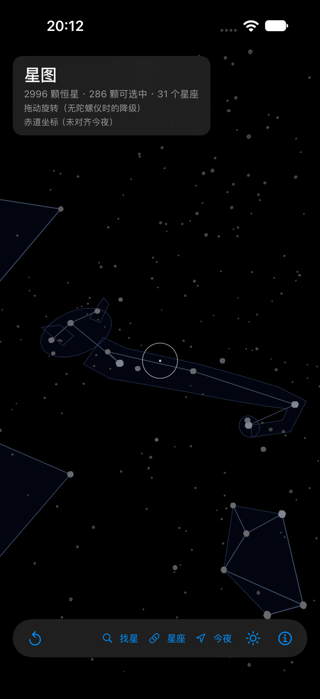
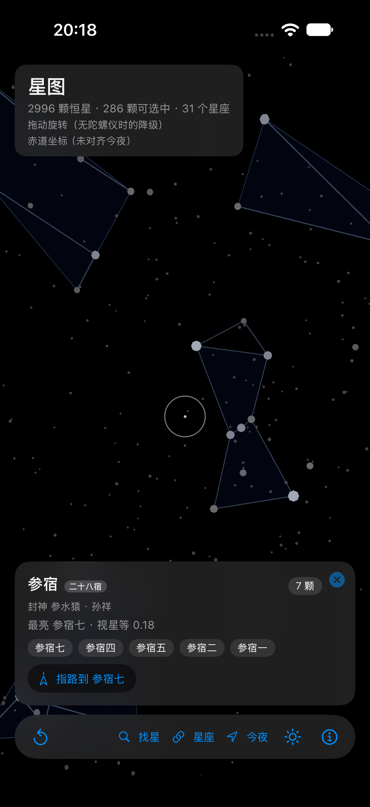

# SpaceWalker

举着手机看真实天空。星表按 J2000 赤道坐标渲染，用陀螺仪把星图对齐到你此刻的朝向，再把中国星官、二十八宿与《封神演义》的星君名号叠在同一片天上。

| 星座图形轮廓 | 星官分组卡 | 今夜此刻最适合看 |
|---|---|---|
|  |  |  |

## 功能

| 模块 | 内容 |
|---|---|
| 星表 | HYG v4.1 过滤出 2996 颗（视星等 ≤ 5.5）；有专名且 ≤ 4.5 等的 286 颗可选中 |
| 姿态 | CoreMotion 完整四元数直驱场景，67Hz 直写实体，不经过 SwiftUI 状态 |
| 地平对齐 | 恒星时 + 纬度算出地平旋转；航向可用磁力计、朝北一键、或「以某颗星校准」反解 |
| 准星选中 | 停留 0.6s 触发，换目标重计、丢失按 1.5/s 衰减、离开 0.3s 才可再次触发 |
| 星卡 | 中文传统名优先、拉丁副标题；星官与序号从名字解析；二十八宿四象；封神一行 |
| 封神星榜 | 第九十九回 369 条名讳，按八部十五门浏览与检索；43 位有星官对应者可一键定位；星卡上的封神行反向跳回星榜并高亮 |
| 一百单八将 | 天罡三十六、地煞七十二与梁山座次逐位对照，含两书七处星名异写 |
| 星座 | 31 个星座连线；大熊 / 天蝎 / 狮子有图形轮廓；88 星座全部有中文名与中西两段来头 |
| 分组 | 301 个中国星官（227 个有连线）、二十八宿、31 星座、经典组合；可按封神名号（如「参水猿」）检索并定位 |
| 星官连线 | 按 Stellarium 中国星空文化的成员表绘制，814 段；聚焦某个星官时自动展开 |
| 观赏 | 最佳观赏期（子夜上中天月份 ±1）与「今夜此刻」榜单（高度 65% + 亮度 35%） |
| 今夜导览 | 把榜单串成一句话：此刻最该看什么、在哪个方位、怎么认出它；可逐站指路 |
| 找星 | 四路检索（中文星名、拉丁专名、星座、俗称）+ 指路（左转 N° · 抬高 M°） |
| 时间滑块 | ±12 小时拖动，星空实时旋转；「此刻」一键回位（用于讲季节与可见性） |

界面截图见 `docs/images/`。

## 运行

要求：Xcode 27 及以上、iOS 26 及以上的真机（模拟器可看星图，但没有陀螺仪）。

```bash
brew install xcodegen
xcodegen generate
open SpaceWalker.xcodeproj
```

两个依赖包已内嵌在 `Packages/`，clone 后不必额外准备：

| 目录 | 用途 | 许可 |
|---|---|---|
| `Packages/TGReduxKit` | 单向数据流、状态切片 | MIT |
| `Packages/TGFeatureFlag` | 功能开关、调试面板 | MIT |

只保留 `Package.swift` 与 `Sources/`（各自上游仓库的 `.build` 有 247 MB，已剔除）。详见 `Packages/README.md`。

签名团队写在 `project.yml` 的 `DEVELOPMENT_TEAM`（当前 `UKXWZ3FS84`），换成你自己的即可；只改 pbxproj 会在下次生成时被覆盖。

真机安装：

```bash
xcodebuild -project SpaceWalker.xcodeproj -scheme SpaceWalker \
  -destination 'generic/platform=iOS' -configuration Debug \
  -derivedDataPath build build
xcrun devicectl device install app --device <UDID> build/Build/Products/Debug-iphoneos/SpaceWalker.app
```

## 结构

```
Sources/App/          入口、路由、Redux 装配、功能开关
Sources/Features/
  Session/            会话能力矩阵、生命周期、日志
  Placement/          平面放置与数学
  Permission/         相机权限门与解释页
  Probes/             帧率、漂移、探针
  Space/              太阳系与星系天空盒（A 阶段）
  Sky/                星表、姿态、地平对齐、拾取、分组、观赏期（B 阶段）
  Prototype/          原型模式
Sources/Resources/    stars.json、galaxy-equirect.jpg
Tests/                单元测试（221 项）
docs/                 PRD、ADR、门禁证据、素材清单
```

星图的一帧数据流：

```
CMMotionManager(67Hz) → DeviceAttitude(平滑 + 换基) → root.orientation
SkyObserver(纬度/恒星时/航向) → field.orientation(地平旋转)
                              ↓
        星桶网格 + 星座连线 + 图形轮廓（全部挂在 field 下）
                              ↓
        RealityView 投影 ← pick / 准星 / 卡片
```

拾取必须走 `field.convert(position:to:)`：漏掉这一层，可见天空与判定天空会差一整个地平旋转角。

## 调试开关

启动参数（Debug 构建，`devicectl --environment-variables` 或 scheme 环境变量）：

| 开关 | 作用 |
|---|---|
| `SPACEWALKER_MODE=sky\|prototype` | 启动路由 |
| `SPACEWALKER_ALIGN=1` | 启动即开启定位与地平对齐 |
| `SPACEWALKER_TIMEOFFSET=3` | 启动即把观测时刻偏移若干小时（±24） |
| `SPACEWALKER_LAT=31.25 SPACEWALKER_LON=120.6` | 用模拟坐标代替定位（模拟器无定位时用） |
| `SPACEWALKER_AIM=Ori` | 把指定星座移到视野中心 |
| `SPACEWALKER_GROUP=参宿` | 定位并弹出分组卡 |
| `SPACEWALKER_FENGSHEN=1` | 启动即打开封神星榜 |
| `SPACEWALKER_FENGSHEN=斗部` | 直达该部 |
| `SPACEWALKER_FENGSHEN=北斗` | 直达该星官对应的星君并高亮 |
| `SPACEWALKER_FENGSHEN=水浒` | 直达一百单八将 |
| `SPACEWALKER_QUERY=参水猿` | 打开找星面板并预填查询 |
| `SPACEWALKER_FINDER=1` | 启动即打开找星面板 |
| `SPACEWALKER_GUIDE=Vega` | 直接进入指路模式 |
| `SPACEWALKER_PICKPROBE=1` | 逐星往返拾取探针，输出 `sky.pickProbe` |
| `SPACEWALKER_MOTIONLOG=1` | 每秒输出姿态采样率与朝向 |
| `SPACEWALKER_SKYMOTION=0` | 关闭姿态跟随（回到拖动） |
| `SPACEWALKER_STAR=Alnitak` | 直接弹出指定星卡 |
| `SPACEWALKER_REGION=Ori` | 打开指定星座来头面板 |
| `SPACEWALKER_FORCE_PERMISSION=denied\|restricted\|authorized` | 强制相机权限态 |
| `SPACEWALKER_FORCE_DEGRADED=collision\|all\|occlusion` | 强制能力降级 |
| `SPACEWALKER_AUTOPLACE=1` | 自动放置（A 阶段） |

## 测试

```bash
xcodebuild test -project SpaceWalker.xcodeproj -scheme SpaceWalker \
  -destination 'platform=iOS Simulator,name=iPhone 18 Pro'
```

221 项单元测试，覆盖星表数学、姿态换基、地平旋转、拾取预筛、停留状态机、星官解析、图形包含关系、耳切三角化、观赏期排序。

## 数据与许可

代码 MIT。`Sources/Resources/stars.json` 来自 HYG Database v4.1，为 **CC BY-SA 4.0**，需署名并以相同许可分发；星系天空盒来自 NASA，公有领域。详见 [THIRD-PARTY.md](THIRD-PARTY.md)。

星官、二十八宿、封神名号属于公有领域的传统知识；本项目的释义文案、星座连线与图形轮廓为自绘。

## 路线图

- 今夜导览：把榜单串成 5 站，逐站指路
- 认星座小测：亮出连线让用户选名字
- 更多图形轮廓（猎户、天鹅、仙后）与 88 星座释义补齐
- 深空天体（Messier）图层
