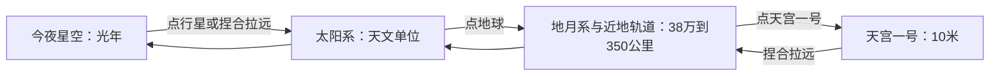

# 星槎改版：尺度阶梯

## 现状结论（为什么会"偏离、不深"）

- 三个尺度只靠底部页签硬切：`Sources/App/ContentView.swift` 用 `switch store.state.route` 分别渲染 `SpaceView`、`SkyView`、`TiangongView`，彼此不共享任何状态。
- 三座桥都断了：
  - 星图里没有太阳、月亮和行星（`Sources/Features/Sky` 中零命中）。
  - 太阳系里没有月球和卫星，行星位置来自固定的 `startPhase`，不是真实日期的位置（见 `Sources/Features/Space/SolarSystemModel.swift`）。
  - 天宫一号场景里没有地球，只有一个抽象的 90 分钟轨道时钟。
- 投入不均：星图约 7000 行，其中封神、水浒等文化内容占了很大比重；太阳系只有约 800 行，9 个天体、每个一句介绍，是整条链里最薄的中间层。
- 缺一把贯穿全程的"尺子"：`stars.json` 只有 `ra/dec/mag/ci/name/con/hip` 字段，没有距离，用户感受不到"光年到米"的数量级跨度。

## 目标形态

- 每一层只回答一个问题，并把用户引向下一层：
  - 今夜星空：我看到的光从多远来？
  - 太阳系：那颗"亮星"其实是行星，它在哪？
  - 地月系与近地轨道：天宫离我们有多近？
  - 天宫一号：它长什么样、怎么对接？
- 常驻一条数量级尺子（例如 `10^17 m · 25 光年`），层间切换时连续滚动。
- 底部三个页签替换为这条竖向尺度阶梯，作为快速跳转入口。

## 第 0 步：先定产品文档（不动代码）

- [docs/PRD.md](docs/PRD.md) 升到 v1.0，新增"尺度阶梯"一章，写清四层、层间转场、尺子和每层的单一问题。§3.2 里"不做天文科普大全"仍然保留，用来约束每层的深度上限。
- 新增 `docs/adr/ADR-0006-scale-ladder.md`，用连续缩放替代三页签，标注 Supersedes ADR-0002 中"三个独立阶段"的产品表述。
- 写明技术取舍：**不做单一场景跨 26 个数量级**（会遇到浮点精度和 RealityKit 深度范围的限制）。改为每层独立场景，再用"机位对齐交接"实现视觉上的连续缩放：
  1. 出场层把镜头推到边界机位；
  2. 尺子滚动，同时做交叉淡化；
  3. 入场层从匹配的机位开始。
- 这样仍遵守 FR-X-03' 的"每次进入都重建渲染树"规则。
- 在 [GLOSSARY.md](GLOSSARY.md) 补充术语：尺度层、尺度阶梯、交接机位、数量级尺子。

## 第 1 步：共享地基（纯逻辑，先写测试）

- **离线星历**：新增 `Sources/Features/Ephemeris/`。
  - 行星用 JPL "Approximate Positions of the Planets"（Standish）的轨道根数加变化率，算出日心坐标和地心赤经赤纬。
  - 月球用 Meeus 低精度算法，得到位置和相位。
  - 全部是纯函数，单测对照 JPL Horizons 取的固定参考值，误差阈值写进测试。
  - 太阳系层和星图层共用这一份星历，保证两层看到的行星位置一致。
- **恒星距离**：扩展 [tools/build-catalogs.py](tools/build-catalogs.py)，从 HYG 导出 `dist` 字段（秒差距），重新生成 `Sources/Resources/stars.json`；`Star` 增加 `distanceLightYears`。
- **尺度模型**：新增 `ScaleLevel` 枚举（四层），每层带代表尺度、尺子文案和交接机位。`AppRoute` 演进为基于 `ScaleLevel` 的路由（见 [Sources/App/AppState.swift](Sources/App/AppState.swift)），reducer 支持 `descend(to:)` 和 `ascend` 两个动作。

## 第 2 步：逐层做深，并接上桥

- **今夜星空**（`Sources/Features/Sky/`）：
  - 用星历把太阳、月亮（含相位）和五颗肉眼行星画进星图，可以被准星选中。
  - 星卡增加距离，以及"这束光出发于某年"一行。
  - 行星卡上设"进入太阳系"主操作，进入后聚焦到该行星此刻的真实位置。
  - 封神星榜、一百单八将和封神行收进图层菜单下的"文化"开关，默认关闭；入口和功能本身不删。
- **太阳系**（`Sources/Features/Space/`）：
  - 行星改用星历的真实日期位置，时间轴以"今天"为原点。
  - 新增"真实比例"开关，配一句话说明太阳系有多空。
  - 聚焦行星时显示主要卫星：月球、伽利略卫星、土卫六。
  - 加小行星带和柯伊伯带粒子环。
  - 信息卡增加"光从太阳到这里需要多久"。
  - 点地球进入下一层。
- **地月系与近地轨道（新增）**：新增 `Sources/Features/EarthOrbit/`。
  - 地球程序化着色，或使用 NASA Blue Marble 公共领域贴图，同步记入 [THIRD-PARTY.md](THIRD-PARTY.md)。
  - 远景显示地月距离；近景显示天宫一号轨道（倾角 42.77°、高度约 350 公里）、星下点轨迹和酒泉发射场标记。
  - 配一句类比，如"地球若是篮球，天宫只在球面上方约 7 毫米"。
  - 太阳方向取自星历。
  - 再入叙事在这一层补一个"从地球外看坠入南太平洋"的镜头。
  - 点天宫一号进入下一层。
- **天宫一号**（`Sources/Features/Tiangong/`）：
  - 拆装、对接、剖面、工程图、再入保持不动，原有测试零改动通过。
  - `TiangongScene.swift` 第 145 行附近那个自转的太阳方向改为接收上一层传入的值。
  - 史实面板增加"回到轨道"入口。

## 第 3 步：连续缩放与首次体验

- 新增层间转场协调器（`Sources/App/ScaleTransition.swift`）：
  - 触发方式有三种：捏合越过层边界、点选下钻对象、在尺度阶梯上点选。
  - 统一使用 450ms 的相机原语（沿用 `PRD-UI-v1` 动效表）。
- 改造 [Sources/App/ChromeLayout.swift](Sources/App/ChromeLayout.swift) 和 [Sources/App/ChromeState.swift](Sources/App/ChromeState.swift)：底部页签替换为竖向尺度阶梯，主操作区仍保留在底部。
- 首次启动的"从今夜到天宫"导览约 60 秒：
  - 从当前星空开始，经过一颗今晚可见的行星、太阳系、地球和轨道，最后落到天宫一号。
  - 每一站一句话，可跳过。
  - 它同时让审核员在一分钟内看懂主线。

## 第 4 步：验收

- 单测：星历参考值、星表距离、`ScaleLevel` 路由的往返不变量、转场状态机、"文化"图层开关。
- UI 测试：从 `SkyCheck` 扩展出"四层下钻再逐层返回"的截图链，并断言尺子文案。
- 真机人工门禁：四层往返不黑屏，帧率沿用 NFR-01 口径，首次导览录一次。
- 文案红线不变：不称"空间站"、无网络请求、离线可用。

## 不在本轮范围内

- 中国空间站实时过境：需要联网获取轨道数据，会推翻"无网络请求"的隐私答复。
- 英文本地化。
- 提审材料：由你在最后补齐。